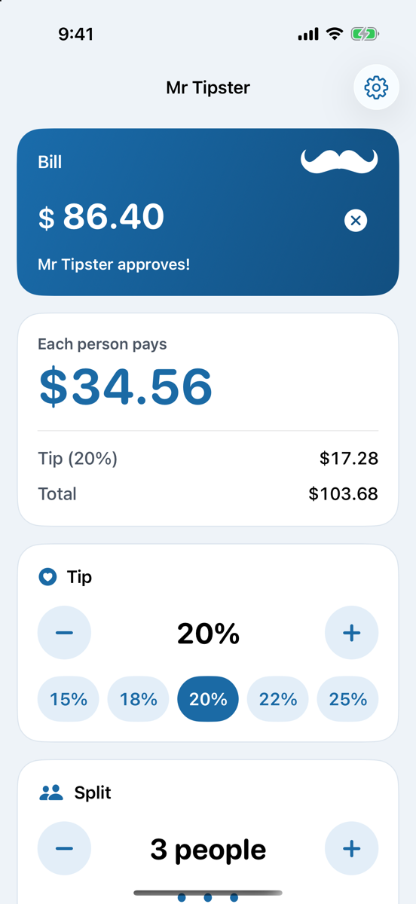
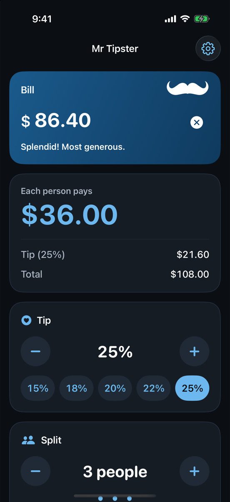
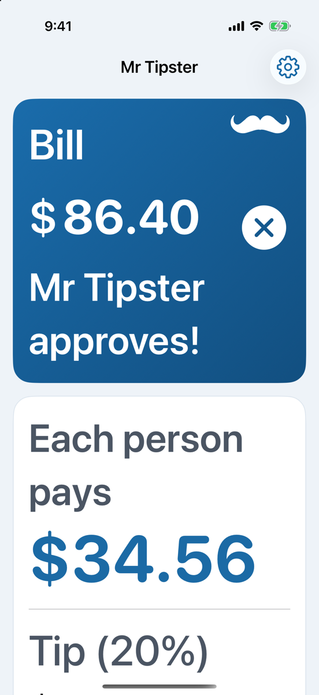

# Mr Tipster

A tip calculator with a mustache. Type the bill, pick a tip, split it with friends, and
Mr Tipster lets you know how he feels about your generosity.

<p>
  
  
  
</p>

## Features

- **Instant results.** The bill field has focus on launch, so you can open the app and start typing. Tip, total and each person's share update as you type, with rolling-number animations.
- **Tip your way.** Quick picks (15–25%) plus a −/+ control for any whole percentage from 0 to 50%.
- **Split the bill** between up to 50 people. Each share is rounded up to the cent, so the group never comes up short.
- **Round up** each person's share (or the total, when you're not splitting) to the next whole dollar, euro, pound or rupee, or the next ¥100.
- **Mr Tipster reacts.** His mustache droops at stingy tips, curls up at good ones, and does a little twirl (with a haptic) when you're generous.
- **Remembers your bill** if you come back within 10 minutes, and starts fresh after that.
- **Currencies:** follow the device region automatically, or pick US dollar, euro, British pound, Japanese yen or Indian rupee. Numbers always use your device's format.
- **Settings** for the default tip.
- **Light and dark**, with light, dark and tinted app icons.

### Accessibility

- VoiceOver: every control has a label, value and traits. The tip and people controls are single adjustable elements (swipe up or down), and their values include the new total, so you hear "21%, Total $104.54" as you adjust. Quick-tip buttons, the round-up switch and pauses in typing announce the new total.
- Voice Control and Switch Control: the −/+ controls also offer named actions ("Increase tip", "Add a person").
- Dynamic Type up to AX5. Layouts stack vertically at accessibility sizes instead of truncating.
- WCAG AA contrast in light and dark, plus stronger colors and borders with Increase Contrast.
- Reduce Motion turns off the number roll, the mustache twirl and other movement.
- UI tests run Xcode's accessibility audit in light, dark and at the largest text size.

## Building

Requirements: Xcode 26 or later (built with Xcode 27). The app targets iOS 18+, uses Swift 6 and has no third-party dependencies.

```sh
open MrTipster.xcodeproj   # then Run on any iPhone simulator
```

or from the command line:

```sh
xcodebuild -project MrTipster.xcodeproj -scheme MrTipster \
  -destination 'platform=iOS Simulator,name=iPhone 17 Pro' test
```

The project is generated with [XcodeGen](https://github.com/yonaskolb/XcodeGen) from `project.yml`. Both are committed. After adding or removing files, run `xcodegen generate`.

### Layout

| Path | What's there |
| --- | --- |
| `MrTipster/Model` | `TipCalculator` (Decimal tip math), `BillInput` (bill entry cleanup), `SessionStore` (the 10-minute memory), `TipperModel` (screen state), `Mood` |
| `MrTipster/Views` | SwiftUI views, the palette (`Theme`), and the mustache as vector geometry |
| `MrTipsterTests` | Swift Testing unit tests for the model |
| `MrTipsterUITests` | Accessibility audits and a smoke test |
| `Scripts/make-icon.swift` | Draws the app icons from the same mustache path the app uses |

Debug builds accept launch arguments for screenshots and tests, e.g.
`-resetState YES -demoBill 86.40 -demoTip 20 -demoPeople 3 -autoFocus NO -scrollToBottom YES -showSettings YES`.

## History

Originally built in 2017 as Mary Martinez's CodePath iOS pre-work (Swift 3, UIKit and
storyboards). Rebuilt in SwiftUI in 2026. The original code is in the git history, and the
original walkthrough is at [docs/2017/TipsterRevision2.gif](docs/2017/TipsterRevision2.gif).
